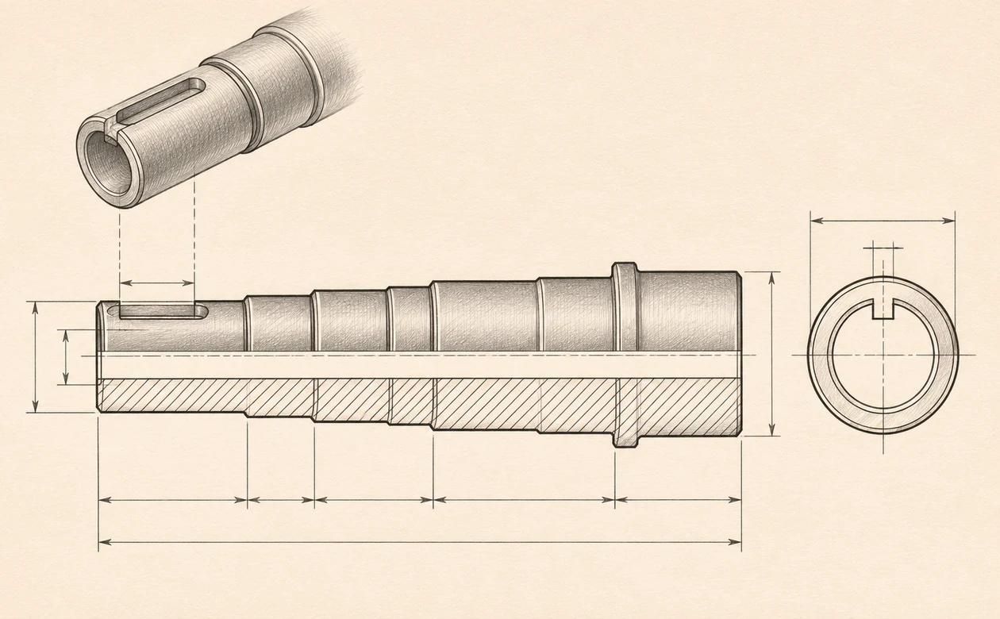

# Metall Showcase

  

Лендинг Metall показывает путь от чертежа до 3D-модели, маршрута обработки и предварительной сметы. На сайте видно, как Metall помогает конструктору найти спорные размеры до передачи детали в цех, а технологу проверить заготовку, операции и основания расчёта.

## Что показывает сайт

- **Проверка чертежа.** Metall принимает PDF, PNG, JPEG или WebP. Система строит 3D-модель по чертежу или использует приложенный STEP, сверяет требования с измерениями и указывает, что нужно уточнить.
- **От заготовки до детали.** В интерактивном просмотре можно сравнить заготовку, черновую и готовую модели. На схеме видно, как Metall готовит маршрут, рассчитывает машинное время и формирует предварительную смету работ.
- **База знаний и помощник.** На сайте описаны справочник из более чем 3 000 материалов, подбор круглого проката по сортаменту, формулы мехобработки и настройка парка станков. Инженерному помощнику можно задавать вопросы даже во время обработки чертежа.
- **Планирование производства.** Предварительный расчёт помогает оценить время партии, спланировать загрузку станков и обосновать срок и цену в тендерном предложении.

## Демо Metall

В демо доступен сохранённый расчёт вала. Можно повернуть 3D-модель, изучить паспорт детали, маршрут и основания сметы, скачать STEP и печатные формы.

[Открыть демо Metall](https://lotargo.github.io/Metall-DEMO/)
